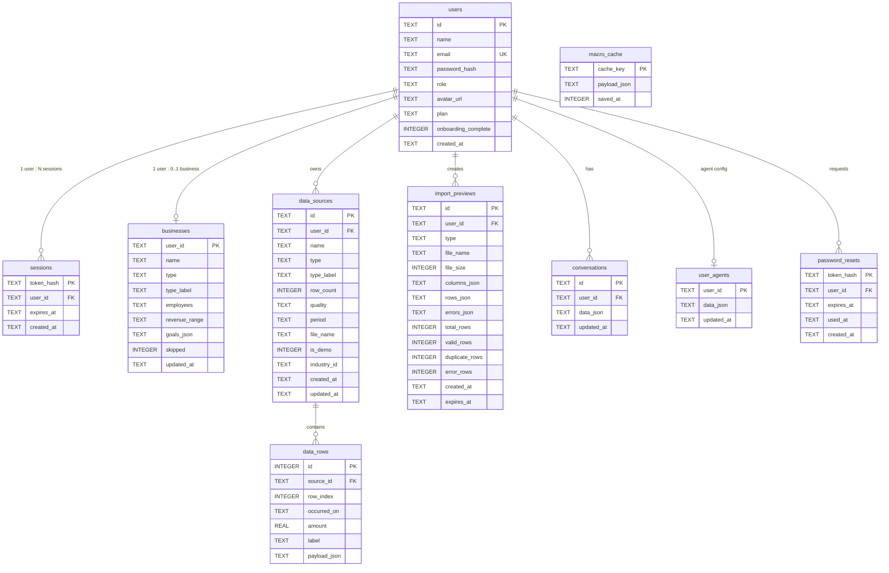

# ROOKAR Database Diagram

> Diagram only — ยังไม่ได้สร้าง D1 database จริง
> Schema ตรงกับ `migrations/0001_init.sql`

## ER Diagram



## Relationships

| Parent | Child | Cardinality | On delete |
|---|---|---|---|
| `users.id` | `sessions.user_id` | 1 : N | CASCADE |
| `users.id` | `businesses.user_id` | 1 : 0..1 | CASCADE |
| `users.id` | `data_sources.user_id` | 1 : N | CASCADE |
| `data_sources.id` | `data_rows.source_id` | 1 : N | CASCADE |
| `users.id` | `import_previews.user_id` | 1 : N | CASCADE |
| `users.id` | `conversations.user_id` | 1 : N | CASCADE |
| `users.id` | `user_agents.user_id` | 1 : 0..1 | CASCADE |
| `users.id` | `password_resets.user_id` | 1 : N | CASCADE |
| — | `macro_cache` | standalone cache | — |

## Indexes

| Table | Index | Columns |
|---|---|---|
| `sessions` | `idx_sessions_user` | `user_id` |
| `data_sources` | `idx_sources_user` | `user_id`, `updated_at DESC` |
| `data_rows` | `idx_rows_source` | `source_id`, `row_index` |
| `data_rows` | `idx_rows_date` | `occurred_on` |
| `conversations` | `idx_conversations_user` | `user_id`, `updated_at DESC` |
| `password_resets` | `idx_password_resets_user` | `user_id` |

## DBML version (นำไปวางใน dbdiagram.io ได้)

```dbml
Table users {
  id text [pk]
  name text [not null]
  email text [not null, unique]
  password_hash text [not null]
  role text [not null, default: 'owner']
  avatar_url text
  plan text [not null, default: 'Free']
  onboarding_complete integer [not null, default: 0]
  created_at text [not null]
}

Table sessions {
  token_hash text [pk]
  user_id text [not null]
  expires_at text [not null]
  created_at text [not null]

  indexes {
    user_id [name: 'idx_sessions_user']
  }
}

Table businesses {
  user_id text [pk]
  name text [not null]
  type text [not null]
  type_label text [not null]
  employees text [not null]
  revenue_range text [not null]
  goals_json text [not null, default: '[]']
  skipped integer [not null, default: 0]
  updated_at text [not null]
}

Table data_sources {
  id text [pk]
  user_id text [not null]
  name text [not null]
  type text [not null]
  type_label text [not null]
  row_count integer [not null, default: 0]
  quality text [not null, default: 'complete']
  period text [not null]
  file_name text [not null]
  is_demo integer [not null, default: 0]
  industry_id text
  created_at text [not null]
  updated_at text [not null]

  indexes {
    (user_id, updated_at) [name: 'idx_sources_user']
  }
}

Table data_rows {
  id integer [pk, increment]
  source_id text [not null]
  row_index integer [not null]
  occurred_on text
  amount real
  label text
  payload_json text [not null]

  indexes {
    (source_id, row_index) [name: 'idx_rows_source']
    occurred_on [name: 'idx_rows_date']
  }
}

Table import_previews {
  id text [pk]
  user_id text [not null]
  type text [not null]
  file_name text [not null]
  file_size integer [not null]
  columns_json text [not null]
  rows_json text [not null]
  errors_json text [not null]
  total_rows integer [not null]
  valid_rows integer [not null]
  duplicate_rows integer [not null]
  error_rows integer [not null]
  created_at text [not null]
  expires_at text [not null]
}

Table conversations {
  id text [pk]
  user_id text [not null]
  data_json text [not null]
  updated_at text [not null]

  indexes {
    (user_id, updated_at) [name: 'idx_conversations_user']
  }
}

Table user_agents {
  user_id text [pk]
  data_json text [not null]
  updated_at text [not null]
}

Table password_resets {
  token_hash text [pk]
  user_id text [not null]
  expires_at text [not null]
  used_at text
  created_at text [not null]

  indexes {
    user_id [name: 'idx_password_resets_user']
  }
}

Table macro_cache {
  cache_key text [pk]
  payload_json text [not null]
  saved_at integer [not null]
}

Ref: sessions.user_id > users.id [delete: cascade]
Ref: businesses.user_id - users.id [delete: cascade]
Ref: data_sources.user_id > users.id [delete: cascade]
Ref: data_rows.source_id > data_sources.id [delete: cascade]
Ref: import_previews.user_id > users.id [delete: cascade]
Ref: conversations.user_id > users.id [delete: cascade]
Ref: user_agents.user_id - users.id [delete: cascade]
Ref: password_resets.user_id > users.id [delete: cascade]
```

## Notes

- `sessions` และ `password_resets` เก็บเฉพาะ token hash ไม่เก็บ token ดิบ
- `avatar_url` ตอนนี้เก็บ URL/ค่า default; แผนถัดไปคือย้ายรูปจริงไป R2 และเก็บ object key/URL ในคอลัมน์นี้
- `macro_cache` เป็น cache ของข้อมูลเศรษฐกิจจริงจาก IMF / World Bank / NSO (TTL 6 ชั่วโมง) ไม่มี FK
- `import_previews.rows_json` และ `data_rows` อาจมีข้อมูลใหญ่ — ตอนย้ายไป D1 ต้อง batch insert และระวัง row/query limit
- `data_rows.id` เป็น `INTEGER PRIMARY KEY AUTOINCREMENT`
- D1 migration อยู่ที่ `migrations/0001_init.sql`
